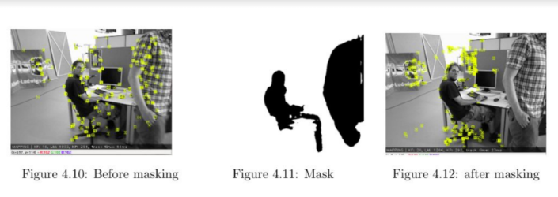
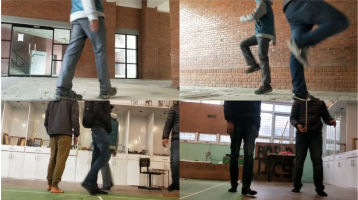
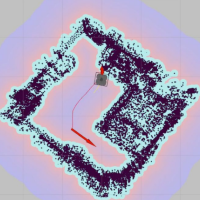

# Real-Time Visual Localization and Mapping of a Mobile Robot in Dynamic Environments

Final-year project, B.E. Electronics & Communication, IOE Pulchowk Campus (Tribhuvan University), submitted April 2021.

A ground robot builds a map and localizes itself using **one ordinary webcam**. A segmentation network fast enough for a laptop CPU masks out people, so the people walking past don't corrupt the map or the pose estimate.

**[Report (PDF)](https://drive.google.com/file/d/1lvuPHT_39ZQ7KCuALKRqvdw2jXcDsk9Y/view)** · **[Poster](https://drive.google.com/file/d/1Eo2sRF7BE8US4C0k_DeNbiiNz-j3sdYm/view)** · **[Slides](https://drive.google.com/file/d/1OfZqfcIp2VZU6zhXoh_O_n8hLJminaei/view)** · **[Demo video](https://vimeo.com/757833955)** · **[Portfolio page](https://shreyniraula.com.np/projects/major-project/)**

**Team:** Nischal Maharjan, Rashik Shrestha, Sajil Awale, Shrey Niraula · **Supervisor:** Jitendra Kumar Manandhar

> This repository is the project's index page. The code was written as a team and lives in the repositories listed under [Where the code is](#where-the-code-is), linked at the commits used for the final version.

## The problem

Feature-based visual SLAM assumes the scene doesn't move. A person walking past adds feature points that move between frames. Those points give wrong matches, which corrupt the camera pose and leave false landmarks in the map. Indoor robots work around people constantly.

DynaSLAM solves this with Mask R-CNN, which is too slow without a GPU. This project asks whether a real-time semantic segmentation model can do the same job on a laptop CPU.

## How it works

  
   Click the diagram to open it full size. Source: <a href="docs/architecture.mmd">docs/architecture.mmd</a>

1. **Camera on the robot.** The Raspberry Pi sends compressed webcam frames over Wi-Fi to a PC running the ROS master. The Pi is too slow to run SLAM or segmentation.
2. **Masking people.** ICNet, fine-tuned on a custom robot's-eye-view walking dataset, outputs a binary person mask for each frame.
3. **SLAM with the mask.** Custom ROS nodes use a `message_filters` time synchronizer to pair each frame with its mask, then pass both to OpenVSLAM. ORB features inside the mask are dropped before tracking and mapping. The camera pose is converted into the ROS coordinate frame and published as `/odom`, `/pose` and the `odom → base_footprint` transform, replacing wheel odometry.

   

   *Left: ORB features (yellow) land on the moving people. Middle: the person mask. Right: with the mask, features come only from the static scene.*

4. **2D map.** The sparse 3D map is rotated into the floor plane, filtered by height and projected to a 2D occupancy grid. A single camera can't measure real distances, so the grid and odometry were scaled by hand from measured room dimensions.
5. **Navigation.** `move_base` plans an A* path and sends `/cmd_vel` back to the Pi. The Pi forwards it to the Arduino, which converts it into left and right wheel speeds (wheel radius 3.15 cm, wheel base 26.15 cm).

## Results

**Effect of masking on the TUM dynamic benchmark** (absolute trajectory RMS error, averaged over several runs; see report §5.1):

| Sequence | Without mask | With ICNet mask |
|---|---|---|
| fr3 walking_xyz | 23.7 cm | **1.8 cm** |
| fr3 walking_rpy | 51.5 cm | **4.0 cm** |

Static baselines: fr2_desk 9.8 cm, fr2_pioneer_slam3 10.2 cm.

**Segmentation, speed vs. accuracy, on a CPU only** (Intel i5-8250U):

| Model | mIoU, Locus office val | FPS | mIoU, APSIS | FPS |
|---|---|---|---|---|
| ICNet (pretrained) | 80.08 | 26.5 | 83.69 | 20.9 |
| BiSeNet v1 | 84.09 | 13.7 | 84.03 | 12.5 |
| DeepLabV3+ | 88.77 | 7.3 | 84.84 | 6.7 |
| UNet+ | 82.59 | 5.6 | 84.34 | 7.6 |
| **ICNet fine-tuned (ours)** | **83.27** | **24.0** | 77.63 | 26.2 |

ICNet was the only model fast enough for real-time use. Fine-tuning on the custom dataset raised in-domain accuracy at almost no speed cost. Accuracy on general portrait images dropped, so the model became specialized to the robot's view.

  
  

## Where the code is

| Part | Repository (commit used) |
|---|---|
| OpenVSLAM + custom ROS nodes (`run_slam_with_mask.cc`, `run_localization_with_mask.cc`), launch files, occupancy-grid tool, web viewer | [Visual-Localization-and-Navigation/openvslam_ws @ 896ce61](https://github.com/Visual-Localization-and-Navigation/openvslam_ws/tree/896ce61) |
| Robot-side launch (camera and serial bridge) | [Visual-Localization-and-Navigation/openvslam_bot_ws @ 230a0d6](https://github.com/Visual-Localization-and-Navigation/openvslam_bot_ws/tree/230a0d6) |
| ICNet fine-tuning and mask inference (PyTorch) | [ShreyNiraula/Human-Segmentation-PyTorch, branch `ICnet-semantic` @ 2edad21](https://github.com/ShreyNiraula/Human-Segmentation-PyTorch/tree/2edad21) |
| OpenVSLAM code study (annotated source) | [rashikshrestha/openvslam_commented, branch `shrey`](https://github.com/rashikshrestha/openvslam_commented/tree/edbc52f) |

Key files in `openvslam_ws`:
- `ros/src/openvslam/src/run_slam_with_mask.cc`: syncs image and mask, feeds OpenVSLAM, and publishes odometry and TF
- `ros/src/openvslam/launch/`: launch files for mapping, localization, and both at once
- `generate_occ_grid/plotter.py`: turns the OpenVSLAM map into a 2D occupancy grid
- `ros/src/send_serial/src/send_serial.py`: `/cmd_vel` → Arduino serial

Not published: the ROS `masker` node, the Arduino firmware and the dataset-labeling script.

## My contribution (Shrey Niraula)

- Researched how to handle moving objects. Tested the DynaSLAM approach (pretrained Mask R-CNN): it took 20–30 s per image in our Colab test, far from real time, so the team moved to real-time semantic segmentation.
- Built the **custom walking dataset** for fine-tuning ICNet. Filmed people walking from the robot's camera height (focused on legs) in several places and lighting conditions. Auto-labeled the frames with Detectron2 Mask R-CNN (R50-FPN), converted to binary person masks: 1,435 training and 1,350 validation images.
- Studied OpenVSLAM's internals (tracking module, threading, utilities) with the team, as annotated source code.

## Built with

C++ · Python · ROS (tf2, message_filters, image_transport, move_base, map_server) · OpenVSLAM (ORB features, bundle adjustment, loop closure) · OpenCV · PyTorch · ICNet · Detectron2 · Raspberry Pi · Arduino
